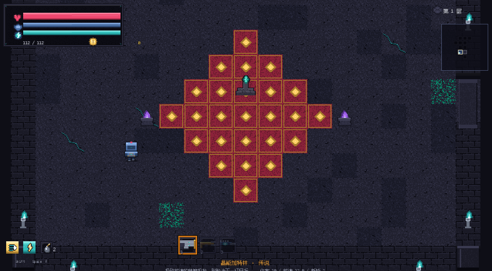

# 晶窟枪魂 · CRYSTAL CAVERN GUNNER

俯视角像素 Roguelite 射击游戏（Godot 4.7.2）。进入随机生成的晶窟地牢，逐层战斗、收集金币与武器、挑战镇守各层的 Boss，在胜利与失败间不断重开。

全部素材（贴图 / 音频 / 字体）均为程序化或人工原创生成，无第三方版权素材。



> **截图说明**：左上角是生命 / 护盾 / 能量条与金币，右上角是**整层小地图**
> （显示所有房间的房型图标与探索状态，按 `Tab` 展开成居中大图），
> 左下角是冲刺 / 技能冷却与炸弹存量，底部中央是三格武器栏。

---

## 〇、一局是什么样的

**先选角色**（3 个职业，各有独立的生命/移速/初始武器/**专属主动技能**与**专属天赋树**），
再打进 8 层晶窟。每层有 5-10 间房：**精英房掉落地牢钥匙**、**宝箱房**、**商店**、**Boss 房**。
右上角常驻**整层小地图**（已探索 / 门相邻 / 未探索三种状态，精英房标橙点），按 `Tab` 展开成居中大图——
先规划「先去哪间拿钥匙」再动身，探索才有决策而不只是推门碰运气。

Boss 的每一招都会在**地面画出精确形状的危险区**并随读条填满（红圈=砸地、走廊=冲撞、扇形=扇形弹幕、
圆环=环形弹幕、紫色圈=闪现落点），最后 25% 会闪烁。**读地面，别读血条。**

### 三个角色

| 角色 | 解锁 | 定位 | 专属技能（Space） |
| --- | --- | --- | --- |
| **晶刃武士** | 初始 | 130 血 / 移速 218，贴脸换命 | **突进斩**：朝瞄准方向瞬突并切开沿途敌人，位移期间无敌 |
| **游晶游侠** | 到达第 2 层 | 92 血 / 暴击 16%+1.95 倍，风筝 | **八方箭雨**：原地向八方各射一枚追踪晶弹，专治被围 |
| **哨戒工程机** | 到达第 4 层 | 护盾 80 / 能量 130，阵地输出 | **哨戒炮台**：丢下一座自动开火的炮台（存在 9 秒） |

三个技能**没有一个是无条件最优**：突进斩要贴脸（远程角色用等于自杀）、
箭雨冷却最长、炮台冷却 12 秒必须提前占位。

### 永久天赋树

每角色一棵，三支线（锋刃 / 晶壳 / 机巧）× 4 层 = 12 个节点，逐层解锁、有前置依赖。
天赋点来自**首通新层（+1）**与**完全通关（+3）**，跨局保留。
首次玩很难猜对加点顺序，所以**洗点随时免费**。

### 敌人：四种新行为原型

| 敌人 | 首次登场 | 行为 |
| --- | --- | --- |
| 影袭者 | 第 3 层 | 半透明潜行逼近（始终留有残影），贴近后**显形 0.85 秒**再突刺；血量全场最低(18)，见红光就撤 |
| 穿地兽 | 第 4 层 | 潜入时**穿过墙体**，在玩家脚下画预警圈后破土砸下 |
| 裂晶虫 | 第 5 层 | 击杀后裂成两只高速碎片（碎片脆、不会再生） |
| 晶巢母体 | 第 6 层 | 自身脆弱但持续产怪；召唤物**有寿命**，清空后它要歇一阵 |

### 武器：19 把，其中 7 把是机制而非数值

原来 12 把枪手感同质（都是「瞄准→开火」）。新增的机制型弹道：

| 武器 | 机制 |
| --- | --- |
| 回旋晶刃 / 碎晶环刃 | 脱手后原路飞回，**去程和返程各能命中一次** |
| 链式电弧 / 守望电枢 | 命中后在敌群之间连锁跳跃，每跳衰减 |
| 晶籽布雷 | 沿途撒雷，敌人**踩上去**才炸（倒着往后走是安全的） |
| 跳弹核 | 撞墙不消失，按反射角改变方向继续飞 |
| 寒晶手枪 | 单发很弱，但给敌人挂减速——控场枪，叠攻速收益最高 |

### Boss：5 个，招式各不相同

除原有冲撞 / 扇形 / 螺旋 / 环形弹幕 / 召唤 / 砸地外，M9 新增：

- **扫射激光**（织弹者）：一根来回扫的长条判定，**站在里面就持续掉血** → 逼你跑出扇区
- **追踪导弹**（晶骸王座）：分批慢速自导弹 → 逼你换位
- **闪现**（晶镰领主）：瞬移到玩家附近炸一圈，**落点必有预警圈** → 逼你重新站位

> Boss 召唤物被清空后会进入**禁召期**（6-8 秒），给玩家一个真实的反打窗口，
> 而不是「丢小怪→清掉→冷却刚好转好→立刻再丢」的无解循环。

---

## 一、安装

### 环境要求

| 依赖 | 版本 | 说明 |
| --- | --- | --- |
| Godot | 4.7.2 stable（Win64） | 使用官方标准引擎即可，无需导出模板 |
| 操作系统 | Windows 10 / 11 | 本项目为键鼠操作 |

### 步骤

1. 解压交付压缩包（zip 内已包含完整工程，不含任何外部依赖）。
2. 确认本机已安装 Godot 4.7.2。若没有，前往 <https://godotengine.org/download/archive/4.7.2-stable/> 下载 Windows 版并解压（例如得到 `D:\godot\Godot_v4.7.2-stable_win64.exe`）。
3. 首次打开前，可选地让引擎导入一次资源缓存（否则首次运行会逐一导入，稍慢）：

```bash
"D:/godot/Godot_v4.7.2-stable_win64.exe" --headless --path "D:/game1" --import
```

> 提示：工程内含 `.godot` 导入缓存时可跳过此步；重新生成的缓存按需自动构建。

---

## 二、运行

所有命令在工程根目录 `D:\game1` 下执行，将引擎路径替换为你本机的实际路径。

### 直接运行游戏

```bash
"D:/godot/Godot_v4.7.2-stable_win64.exe" --path "D:/game1"
```

### 在编辑器中打开（可选，便于调试 / 改资源）

用 Godot 4.7.2 的"导入"选择工程根目录的 `project.godot` 打开即可。

### 运行完整测试

无头自动化测试（覆盖属性 / 武器 / 敌人 / 地牢生成 / 掉落 / Boss / 流程状态机 / 角色 / 天赋 / 新敌人原型 / Boss 新技能，共 1000+ 项）：

```bash
"D:/godot/Godot_v4.7.2-stable_win64.exe" --headless --path "D:/game1" res://tests/test_main.tscn
```

真窗口自检（真实渲染一局：菜单 → 地牢 → Boss 战 → 掉落 → 结算，约 1-2 分钟并输出截图）：

```bash
"D:/godot/Godot_v4.7.2-stable_win64.exe" --path "D:/game1" res://tests/launch_check.tscn
```

### 资源重建（改动贴图 / 音频 / 字体后）

```bash
python tools/build_assets.py        # 重建全部程序化资源（贴图、音频、字体）
python tools/check_charset.py       # 校验中文字体子集是否覆盖全部代码字符
```

---

## 三、操作说明

### 键位

| 按键 | 功能 |
| --- | --- |
| `W A S D` / `↑ ↓ ← →` | 移动 |
| `鼠标左键`（按住） | 射击（连发武器按住连射） |
| `鼠标右键` | 副瞄准（备用操作位） |
| `Shift` | 冲刺（有冷却） |
| `Space` | 主动技能（消耗能量） |
| `F` | 投掷炸弹（消耗炸弹数） |
| `E` | 交互（开门、拾取、祭坛、商店、传送门） |
| `1 / 2 / 3` | 切换武器 |
| `Q / R` | 上一把 / 下一把武器 |
| `Tab` | 小地图：角落小图 ⇄ 居中大图 |
| `Esc` | 暂停 / 恢复 |
| `F2` | 暂停时打开设置面板 |
| `F3` | 显示 / 隐藏帧率 |
| `Enter` | 确认（菜单 / 暂停菜单重开本局） |
| `M` | 暂停时返回主菜单 |

### 玩法流程

1. **开始**：主菜单选「开始游戏」→ 选择起始关卡与角色（有存档时可选「继续上次」）。
2. **探索**：每层随机生成 5-10 个房间——起始房（安全）、战斗房（清空敌人后解锁出口）、精英房（掉落地牢钥匙）、宝箱房、商店房、每层 1 个 Boss 房。右上角小地图显示整层布局与已探索状态。
3. **战斗**：击杀敌人掉落金币 / 能量 / 生命 / 护盾 / 炸弹 / 武器 / 天赋等实体拾取物，靠近自动磁吸。
4. **成长**：在祭坛花费金币祈愿获得临时天赋（暴击 / 伤害 / 移速 / 回能 / 护盾 / 生命），在商店用金币购买武器与补给。
5. **技能**：按 `Space` 释放当前角色的专属技能。注意三个技能的使用场景完全不同（突进斩贴脸、箭雨解围、炮台提前布防）。
6. **天赋**：主菜单「天赋树」为当前角色加点，跨局保留；点错了可以随时洗点。
7. **钥匙与 Boss**：每层需要找到地牢钥匙（精英房掉落）打开 Boss 门。Boss 的每一招都有地面预警贴花，读地面躲避。Boss 战期间房间封锁，清空 Boss（含召唤物）后传送门激活。
8. **通关**：共 **8 层**，清空最深层 Boss 房即通关胜利；生命归零则失败。结算界面会展示本局战绩。
9. **重开**：新一局完全重置金币 / 武器 / 天赋 / 炸弹 / 层数 / 击杀数，仅保留最高层数、天赋分配与累计局数记录。

### 设置

主菜单"设置"或游戏内 `Esc` 暂停后按 `F2`，可调整主音量 / 音效 / 音乐音量、全屏显示、画面晃动、帧率显示。

---

## 四、目录结构

```
game1/
├── project.godot                  # 工程配置：主场景、Autoload、输入映射、渲染/窗口
├── scenes/
│   └── main.tscn                  # 唯一场景入口（主菜单 / 游戏世界 / 结算均在此装配）
├── autoload/                      # 全局单例（project.godot [autoload] 注册）
│   ├── input_config.gd            # 输入映射注册器（须排首位）
│   ├── event_bus.gd               # 全局信号总线
│   ├── save_manager.gd            # 存档读写（继续游戏 / 元数据）
│   ├── game_state.gd              # 一局状态机：金币/武器/天赋/层数/角色/天赋树/存档恢复
│   └── audio_manager.gd           # BGM / SFX 播放
├── scripts/
│   ├── main.gd                    # 场景路由器：主菜单 ↔ 游戏世界 ↔ 结算，暂停管理
│   ├── core/                      # 数值表与共享工具
│   │   ├── game_const.gd          # 全局常量（层数/房间/物理层/波次权重/掉落/技能倍率）
│   │   ├── character_db.gd        # 角色（职业）表：属性 / 初始武器 / 专属技能 / 解锁条件
│   │   ├── skill_db.gd            # 主动技能表（突进斩 / 八方箭雨 / 哨戒炮台 / 冲击波）
│   │   ├── talent_tree.gd         # 永久天赋树：3 角色 × 3 支线 × 4 层
│   │   ├── weapon_data.gd         # 武器数据类（Kind/Rarity/属性/机制参数）
│   │   ├── weapon_db.gd           # 武器数值表与工厂
│   │   ├── enemy_data.gd          # 敌人数据类（Archetype/FIELDS 序列化/行为参数）
│   │   ├── enemy_db.gd            # 敌人数值表/工厂/波次规划
│   │   ├── talent_db.gd           # 天赋表
│   │   ├── dungeon_layout.gd      # 地牢布局算法
│   │   ├── combat_util.gd         # 战斗辅助（伤害/击退计算等）
│   │   └── fx.gd / fx_sprite.gd   # 特效缓存与精灵
│   ├── entities/                  # 战斗实体
│   │   ├── player.gd              # 玩家：移动/冲刺/技能分派/受击/死亡
│   │   ├── enemy.gd               # 敌人基类（状态机/受击契约/减速/寿命）
│   │   ├── enemy_husk.gd          # 近战冲锋（晶壳行者）
│   │   ├── enemy_hexeye.gd        # 远程射击（六目浮灵）
│   │   ├── enemy_bloom.gd         # 自爆（孢晶囊）
│   │   ├── enemy_stalker.gd       # 隐形潜行（影袭者）
│   │   ├── enemy_splitter.gd      # 死亡分裂（裂晶虫）
│   │   ├── enemy_burrower.gd      # 钻地穿墙 + 破土（穿地兽）
│   │   ├── enemy_summoner.gd      # 持续召唤（晶巢母体）
│   │   ├── turret.gd              # 哨戒炮台（工程机技能产物）
│   │   ├── enemy_boss.gd          # Boss 技能状态机（含扫射/导弹/闪现）
│   │   ├── bullet.gd / laser_beam.gd / thrown_bomb.gd / damage_number.gd / training_dummy.gd
│   ├── game/                      # 游戏世界与房间
│   │   ├── game_world.gd          # 世界装配：图层/生成层/生成波次/Boss/换层/结算
│   │   ├── room_builder.gd        # 房间建造与门/出口
│   │   ├── telegraph.gd           # 技能地面危险区预警贴花（圆/环/扇/走廊）
│   │   ├── room_floor.gd / door.gd / portal.gd / chest.gd / altar.gd / shop_pad.gd
│   │   ├── enemy_spawner.gd       # 波次生成器
│   │   ├── pickup.gd / floor_key.gd / camera_rig.gd
│   └── ui/                        # 界面（脚本化构建，无独立 .tscn）
│       ├── main_menu.gd           # 主菜单（开始/继续/选角/天赋树/图鉴/设置/退出）
│       ├── minimap.gd             # 整层小地图（常驻角落 + Tab 大图）
│       ├── hud.gd                 # HUD（血/盾/能量/金币/小地图/武器/天赋/炸弹/Boss血条/暂停面板）
│       ├── result_screen.gd       # 胜利/失败结算
│       └── boot_screen.gd         # 占位启动界面（资源缺失时兜底）
├── assets/                        # 程序化生成的全部资源（ui/tiles/characters/pickups/fx/weapons/audio/fonts）
├── tools/                         # 资源生成脚本（build_assets.py 一键重建）
└── tests/                         # 自动化测试
    ├── test_main.tscn / .gd       # 无头全量测试入口（SUITE_PATHS 注册套件）
    ├── launch_check.tscn / .gd    # 真窗口自检
    └── suites/                    # 分模块测试套件（boot/player/enemy/pickup/dungeon/boss/assets...）
```

---

## 五、扩展方式

### 1. 新增武器

在 `scripts/core/weapon_db.gd` 的 `TABLE` 中加一条记录，图标放入 `assets/ui/weapons/<id>.png`、弹体帧放入 `assets/fx/`，掉落 / 商店 / 测试会自动识别：

```gdscript
"plasma": {
    "display_name": "等离子脉冲炮", "kind": K.PROJECTILE, "rarity": R.RARE, "price": 160,
    "damage": 18.0, "fire_rate": 4.0, "bullet_speed": 480.0, "spread_deg": 2.0,
    "pellets": 1, "energy_cost": 8.0, "crit_bonus": 0.08, "knockback": 120.0,
    "pierce": 2, "bullet_lifetime": 1.4, "auto_fire": true, "recoil": 30.0, "shake": 1.6,
    "sfx": "shoot_rifle", "projectile_frames": ["bullet_p_1"],
    "description": "高能脉冲，可贯穿两名敌人。",
},
```

### 2. 新增角色

在 `scripts/core/character_db.gd` 的 `TABLE` 加一条（`stats` 只写要覆盖的键），
再到 `talent_tree.gd` 的 `TREES` 里给它配一棵同名树（3 支线 × 4 层）。
技能在 `skill_db.gd` 里加。主菜单的「选择角色」与「天赋树」会自动收录，无需再接线。

`unlock` 支持 `{"floor": n}`（到达过第 n 层）与 `{"wins": n}`（通关 n 次），留空 = 初始解锁。

### 3. 新增敌人 / Boss

在 `scripts/core/enemy_db.gd` 的 `TABLE` 中加一条字典，并在文件顶部确认原型对应脚本
（`MELEE_SCRIPT / RANGED_SCRIPT / BOMBER_SCRIPT / BOSS_SCRIPT`，
以及 M9 新增的 `STALKER_SCRIPT / SPLITTER_SCRIPT / BURROWER_SCRIPT / SUMMONER_SCRIPT`）。
普通敌人加入 `game_const.gd` 的 `WAVE_TYPE_WEIGHTS`（**8 层都要写全**，缺键会取不到权重）
即可按层数登场；`archetype: A.BOSS` 的条目会被 `game_world.gd` 的 `_boss_wave_ids()` 按层数排期，无需手动接线。

若需要全新的行为原型：新建 `scripts/entities/enemy_<name>.gd` 继承 `Enemy`，
覆写 `_think()`，在 `enemy_data.gd` 的 `enum Archetype` 加一个值，
并在 `enemy_db.gd` 的 `script_for()` 增加分支。

```gdscript
# enemy_db.gd —— warden 示例（Boss；字段全部供 enemy_boss.gd 状态机读取）
"warden": {
    "display_name": "晶核监守者", "archetype": A.BOSS, "tier": T.NORMAL,
    "max_health": 862.0, "armor": 3.0, "move_speed": 82.0, "body_radius": 17.0,
    "charge_trigger_range": 230.0, "charge_speed": 330.0,          # 冲撞
    "radial_count": 14,       "radial_cooldown": 5.0,              # 环形弹幕
    "summon_ids": ["husk"],   "summon_count": 3, "summon_cap": 6,  # 召唤
    "summon_clear_delay": 6.5,                                      # 小怪清空后的禁召期
    "slam_radius": 96.0,      "slam_cooldown": 5.5,                # 砸地
    "phase_threshold": 0.5,   "fan_count": 6, "fan_cooldown": 4.2, # 阶段 2 解锁扇形
    "spiral_arms": 2,         "spiral_cooldown": 7.0,              # 螺旋弹幕
    # --- M9 新三招（谁会用什么由 enemy_boss.gd 的 _skill_pool() 决定）---
    "sweep_degrees": 80.0,    "sweep_dps": 26.0,   "sweep_cooldown": 8.0,   # 扫射激光
    "missile_count": 3,       "missile_speed": 150.0, "missile_cooldown": 7.0,  # 追踪导弹
    "blink_range": 190.0,     "blink_damage": 24.0, "blink_windup": 0.55,   # 闪现
    "gold_min": 70, "gold_max": 120,
    "drops": {"energy": 0.9, "health": 0.5, "weapon": 0.4, "talent": 0.35},
    "sprite_base": "warden", "sprite_dir": "res://assets/sprites/bosses/",
    "frame_count": 4, "anim_fps": 7.0,
    "description": "镇守晶矿核心的巨型监守者。",
},
```

若需要全新行为原型，新建 `scripts/entities/enemy_<name>.gd` 继承 `Enemy`、覆写 `_think()`，
在 `enemy_data.gd` 的 `enum Archetype` 加值，并在 `enemy_db.gd` 的 `script_for()` 增加分支。

### 4. 新增房间类型

房间种类定义在 `scripts/core/game_const.gd` 的 `enum RoomKind`；布局算法在 `scripts/core/dungeon_layout.gd`（房间数 `MIN_ROOMS_PER_FLOOR` / `MAX_ROOMS_PER_FLOOR`）；世界装配与房间内物体生成在 `scripts/game/game_world.gd` 与 `room_builder.gd`。新增一类房间的大致步骤：

1. 在 `RoomKind` 枚举中增加一个值；
2. 在 `dungeon_layout.gd` 增加该类型的生成分支（决定房间尺寸与连通规则）；
3. 在 `game_world.gd` 进入房间的分支（`_activate_current_room()` 附近）为该类型实例化专属物体（参考 `chest.gd` 宝箱房、`shop_pad.gd` 商店房、`altar.gd` 祭坛房）；
4. 在 `scripts/ui/minimap.gd` 的 `TILE_BY_KIND` 里为新房型配一个图标。

### 5. 调数值

所有数值集中在 `scripts/core/game_const.gd`（全局常量）、`character_db.gd`、`skill_db.gd`、
`talent_tree.gd`、`weapon_db.gd`、`enemy_db.gd`、`talent_db.gd`，改表即可，无需改逻辑代码。

### 6. 跑测试

新增或修改后，先 `--import` 刷新类缓存，再跑无头全量测试与真窗口自检（见"二、运行"）。

---

## 附：已知注意点

- 改动任何 `.gd` 中的中文字符（含注释）后，需重跑 `python tools/build_assets.py font` **并重新 `--import`**，否则像素字体会缺字（Godot 会继续用旧的导入缓存）。字体生成依赖 `fonttools` 与 `numpy`（`pip install fonttools numpy`）。
- 新的测试套件只能在 `tests/test_main.gd` 的 `SUITE_PATHS` 数组注册并运行时 `load()`，不要 `preload` 套件，否则无头测试会挂死。
- **无头测试不会碰你的真实存档**：`SaveMgr` 检测到 headless 环境会自动切到 `user://_test/`。这是必须的——测试里的 `new_run()` 会触发 `_save_meta()`，历史上真的把真实存档的累计局数写成了 5577。若想清测试存档，删掉 `_test/` 目录即可。
- **不要在同一次回复里对同一个文件发多个编辑**：并发编辑会互相覆盖（曾导致 `EnemyData` 的字段声明被 FIELDS 覆盖丢失）。
- 改 `TOTAL_FLOORS` 时必须**同步**更新 `WAVE_TYPE_WEIGHTS` 与 `WAVE_ELITE_CHANCE` 的键（1..TOTAL_FLOORS），缺键会取不到权重表。
- 全部素材为程序化生成，重新运行 `tools/gen_*.py` 会覆盖原文件——如需修改素材，请先修改生成脚本。